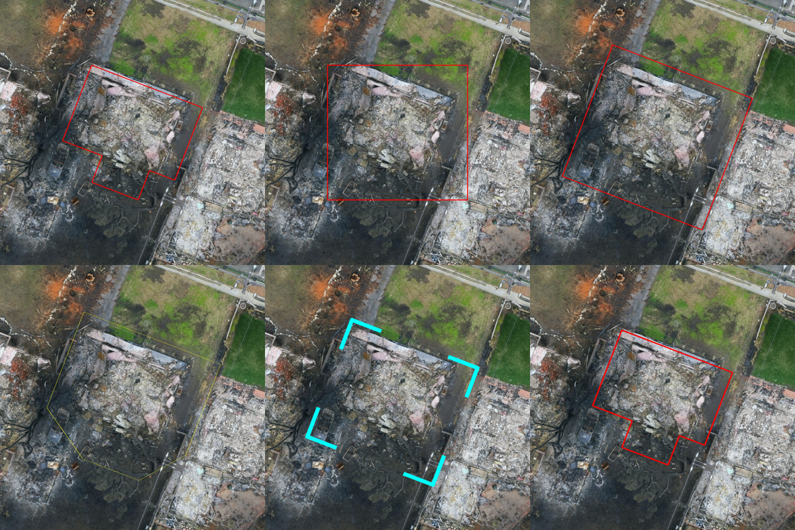

Aerial imagery
==============

Aerial workflows start from a georeferenced raster. That can be a drone
orthomosaic you already have, or a basemap that rAPIdtools stitches together
from Bing or Google tiles. :class:`~rapidtools.processing.AerialImageryExtractor`
then cuts one patch per asset out of the raster and attaches it to the
asset.

Cropping an orthomosaic around each asset
-----------------------------------------

.. code-block:: python

   from rapidtools import AerialImageryExtractor, PhysicalAssetCollection

   buildings = PhysicalAssetCollection.from_geojson('buildings.geojson')
   extractor = AerialImageryExtractor(
       dataset='ortho.tif',                # a TIFF, a folder of TIFFs, or a list
       save_directory='output/crops',
       buffer_m=10,                        # margin around the footprint
       force_square_image=True,
       image_prefix='post_disaster',
   )
   buildings = extractor(buildings)
   buildings['bldg_01'].image_assets[0].properties['wgs84_bounds']

Each crop is saved as a JPEG named after the asset's centroid and attached
as an :class:`~rapidtools.core.ImageAsset`. Its properties record the crop's
WGS84 bounds and the raster it came from. If ``dataset`` is a folder, each
raster in it is opened once and only the assets inside its extent are
cropped from it, so a regional mosaic split across many files needs no extra
code.

Sizing the crop
~~~~~~~~~~~~~~~

``buffer_asset`` sets the margin around the asset. It takes a percentage of
the asset's size (``'20%'``, the default), a distance on the ground
(``'10 m'``, ``'30 ft'``) or a plain number in the raster's units.
``buffer_m`` is a shortcut for meters. With ``force_square_image=True`` every
crop covers a square on the ground, so the model always sees the same
aspect ratio.

Assets on the edge of the imagery
~~~~~~~~~~~~~~~~~~~~~~~~~~~~~~~~~

The extractor reads the raster's own mask to tell imagery from empty space,
so nodata values, alpha bands and internal masks are all respected. By
default it skips a crop when more than 20% of it is empty
(``max_missing_data_ratio``). That rule throws away buildings that straddle
the edge of a flight, so for those, test how much of the footprint itself
is covered instead:

.. code-block:: python

   AerialImageryExtractor(
       'ortho.tif', save_directory='crops',
       min_footprint_coverage=0.3,   # keep if 30% of the footprint is imaged
       pad_edges=True,               # pad with nodata so crops keep their size
   )

Outlining the target asset
--------------------------

In a dense neighborhood a crop shows several buildings, and the model may
describe the wrong one. ``overlay_asset_outline=True`` draws the asset on the
crop so the prompt can refer to "the outlined building". You can choose the
outline's shape, offset, line width and color:

.. code-block:: python

   AerialImageryExtractor(
       'ortho.tif', save_directory='crops', buffer_m=8,
       overlay_asset_outline=True,
       outline_shape='corners',     # 'geometry' | 'bbox' | 'rotated_bbox' | 'convex_hull' | 'corners'
       outline_buffer='2 m',        # push the outline away from the asset
       outline_width='1%',          # of the shorter image side, or pixels
       outline_color='#00ffff',
   )

   One building from the Eaton Fire orthomosaic. Top row: the footprint
   itself, its bounding box, and a rotated bounding box pushed out by 2 m.
   Bottom row: a convex hull with a thin yellow stroke, cyan corner brackets,
   and the footprint with a stroke scaled to the image.

For damage assessment, try corner brackets. A closed line can cover the very
roof edge the model needs to see. Point assets are drawn as a dot, or as a
ring of radius ``outline_buffer`` if you set a buffer.

Basemaps without an API key
---------------------------

If you have footprints but no flight, stitch a basemap of the area.
:class:`~rapidtools.processing.BingOrthomosaicExtractor` and
:class:`~rapidtools.processing.GoogleOrthomosaicExtractor` download the tiles
in parallel and write a georeferenced GeoTIFF, which the rest of the library
treats like any drone orthomosaic:

.. code-block:: python

   from rapidtools import BingOrthomosaicExtractor, BoundingBox

   region = BoundingBox.from_raster('eaton_patch_20250214.tiff')
   tiff = BingOrthomosaicExtractor(zoom_level=19, max_workers=10)(
       region, output_path='eaton_bing.tiff'
   )

Google serves tiles up to about zoom 21 in cities, and also has a hybrid
layer with labels (``layer='y'``). Both providers are reached through the
endpoints their own web maps use. These are unofficial and can change
without notice, so a failed request is logged and skipped rather than
stopping the run.

Per-polygon satellite crops
---------------------------

To get a quick set of training images without building a raster first, use
:class:`~rapidtools.data_sources.GoogleAerialImageExtractor` or
:class:`~rapidtools.data_sources.BingAerialImageExtractor`. They crop tiles
directly for every polygon in a GeoJSON file:

.. code-block:: python

   from rapidtools import GoogleAerialImageExtractor

   with GoogleAerialImageExtractor('output/aerial', zoom_level=20) as aerial:
       paths = aerial.process_geojson(
           'buildings.geojson', buffer_percent=0.1,
           pad_to_square=True, resize_to=(640, 640),
       )

Reading rasters directly
------------------------

Underneath the extractor is :class:`~rapidtools.data_sources.OrthomosaicReader`.
It opens a GeoTIFF once and reports its WGS84 extent. It can crop a patch
around any geometry, with the same margin rules as the extractor, or slide a
window across the whole raster and skip the empty tiles:

.. code-block:: python

   from rapidtools import OrthomosaicReader

   with OrthomosaicReader('ortho.tif') as reader:
       bbox = reader.get_mosaic_bbox_wgs84()
       for image, bounds in reader.generate_tiles(patch_size=50, unit='meters'):
           ...   # a PIL image and its (min_lon, min_lat, max_lon, max_lat)
